<!-- ═══════════════════════════ HEADER ═══════════════════════════ -->

  

 

 

 

<!-- ═══════════════════════════ ABOUT ═══════════════════════════ -->

## About Me

I'm **Imam Hossen**, a Full Stack Developer from Bangladesh. I build web applications end to end — from responsive, animated interfaces in **Next.js** and **React** to APIs and real-time services in **Node.js** and **NestJS**, backed by **PostgreSQL** and **MongoDB**. I also build cross-platform mobile apps with **Flutter** and **Dart**.

I care about clean, scalable code and about turning complex problems into simple, maintainable solutions.

- **Currently building** — full stack projects with Next.js, Node.js and TypeScript
- **Always exploring** — new technologies, patterns and best practices
- **Open to** — full-time roles, freelance work and meaningful open-source collaboration
- **Portfolio** — [imamhossen.vercel.app](https://imamhossen.vercel.app)

 

<!-- ═══════════════════════════ TECH STACK ═══════════════════════════ -->

## Tech Stack

<table>
  <tr>
    <td width="170"><b>Frontend</b></td>
    <td>
      
       
      
    </td>
  </tr>
  <tr>
    <td><b>Mobile</b></td>
    <td>
      
       
      
      
      
      
      
      
      
    </td>
  </tr>
  <tr>
    <td><b>Backend</b></td>
    <td>
      
       
      
      
    </td>
  </tr>
  <tr>
    <td><b>Languages</b></td>
    <td>
      
    </td>
  </tr>
  <tr>
    <td><b>Database &amp; ORM</b></td>
    <td>
      
    </td>
  </tr>
  <tr>
    <td><b>Data &amp; AI</b></td>
    <td>
      
      
      
    </td>
  </tr>
  <tr>
    <td><b>Testing &amp; Quality</b></td>
    <td>
      
       
      
      
    </td>
  </tr>
  <tr>
    <td><b>DevOps &amp; Tools</b></td>
    <td>
      
    </td>
  </tr>
  <tr>
    <td><b>CMS</b></td>
    <td>
      
    </td>
  </tr>
</table>

 

<!-- ═══════════════════════════ GITHUB STATS ═══════════════════════════ -->

## GitHub Analytics

&nbsp;

  

  

 

<!-- ═══════════════════════════ CONTRIBUTIONS ═══════════════════════════ -->

## Contributions

  

<picture>
  <source media="(prefers-color-scheme: dark)" srcset="https://raw.githubusercontent.com/imamhossenbu/imamhossenbu/output/github-contribution-grid-snake-dark.svg" />
  <source media="(prefers-color-scheme: light)" srcset="https://raw.githubusercontent.com/imamhossenbu/imamhossenbu/output/github-contribution-grid-snake.svg" />
  
</picture>

 

<!-- ═══════════════════════════ CONNECT ═══════════════════════════ -->

## Let's Connect

I'm always happy to talk about new opportunities, collaborations or interesting ideas.

<!-- ═══════════════════════════ FOOTER ═══════════════════════════ -->

 

  
    
  If you find my work useful, consider starring a repository — it means a lot.

